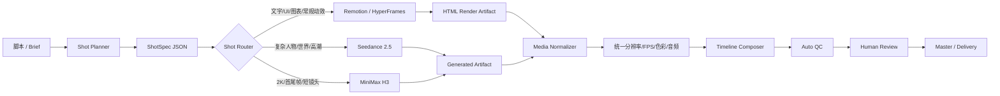
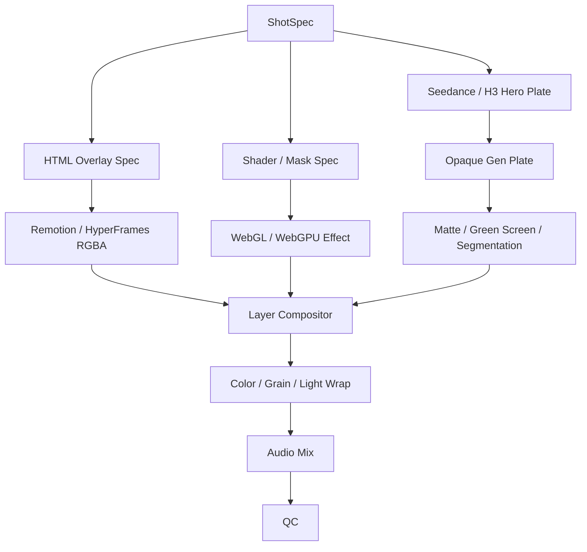
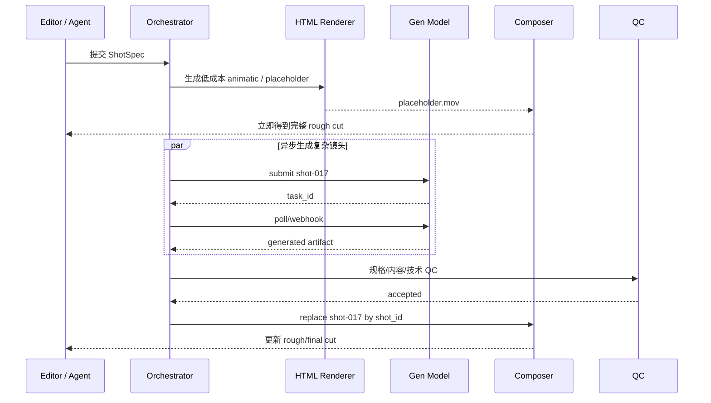
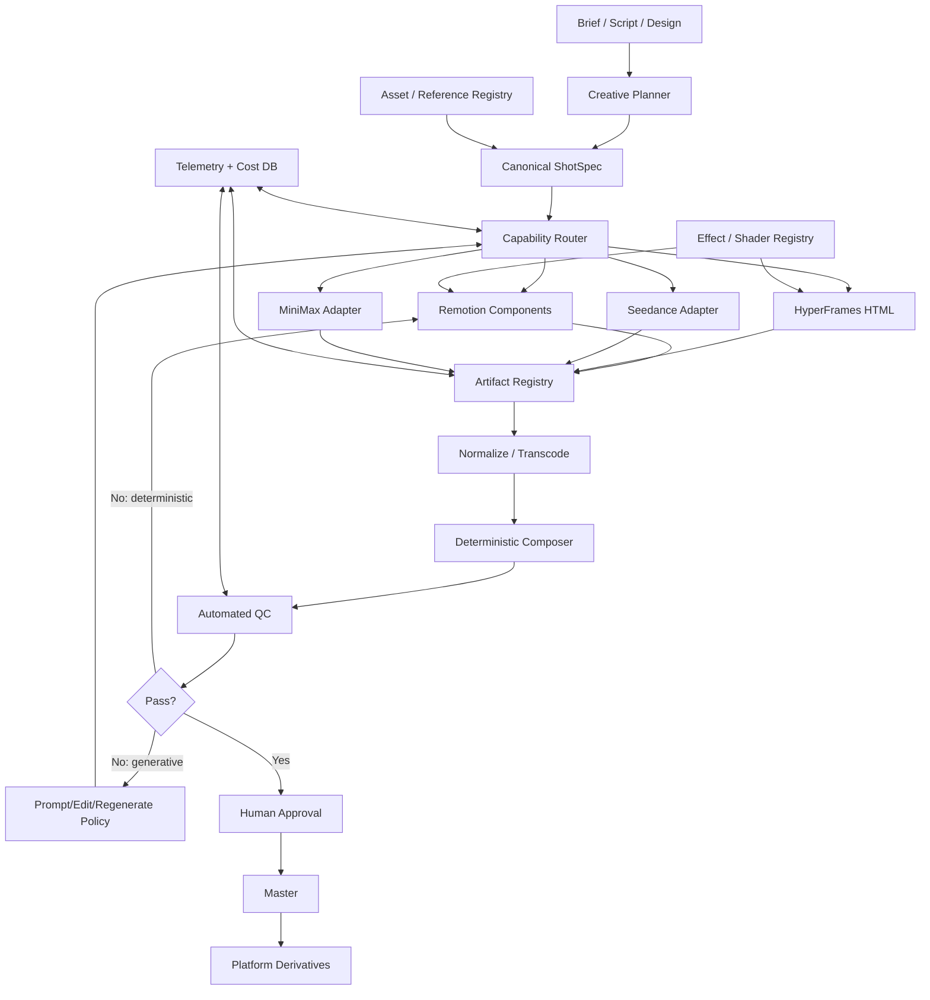

# 混合视频制作体系研究：HTML 可控构建 × 生成式视频模型

## 执行摘要与关键前提

**直接结论：这个方向是成立的，而且比“全生成”或“全 HTML/代码动画”更适合作为长期生产体系。** 最优的边界不是按“技术新旧”划分，而是按**信息熵与修改成本**划分：

> **文字、数据、品牌元素、UI、版式、字幕、常规转场、参数化 Shader、可重复动效 → 尽量留在确定性的 HTML/代码层；人物表演、复杂空间运动、真实世界重构、语义化形变、摄影级光影和高复杂度高潮镜头 → 交给生成模型。**

这样做的原因很直接：Remotion、HyperFrames 这类系统把帧、时间、组件和参数保留为结构化代码，因此一个标题从“20%”改成“25%”通常只需要修改一个属性并局部重渲；生成视频则本质上仍是概率型输出，同样的小修改可能迫使整段重新生成。Remotion 当前以 React 代码作为视频 source of truth，并提供帧级时间控制、Sequence、Three.js/WebGPU、服务端/Lambda 渲染以及透明视频输出；HyperFrames 则更激进地以普通 HTML/CSS/媒体和可 seek 动画作为输入，用 headless Chrome + FFmpeg 按帧确定性渲染。citeturn3view0turn16view0turn16view1turn17view0turn15view0

生成模型一侧，截至 **2026 年 9 月 17 日**，Seedance 2.5 和 MiniMax H3 的生产定位已经出现明显分化。Seedance 2.5 强项是**最长 30 秒单次生成、最多约 50 个多模态参考、局部编辑以及更明确的影视控制能力**；MiniMax H3 强项则是**最高 2K、最长 15 秒、原生立体声、首尾帧/多模态 reference-to-video、清晰的 REST API 与按秒定价**。citeturn5view0turn6view1turn7view1turn7view3turn10view0

我的总体技术建议是：

**主干采用 Remotion 或 HyperFrames；生成层同时封装 Seedance 2.5 与 MiniMax H3，而不是现在就只押一家；ChatCut 更适合作为人工/Agent 编辑与审片界面，而不宜与 Remotion、HyperFrames 一样视作底层 HTML renderer。** ChatCut 的公开产品能力是可编辑时间线、AI Motion Graphics、透明 MG 导出、生成视频和 Agent/Codex 插件；公开资料并没有证明其把“普通 HTML 文档”作为稳定、可版本控制的 canonical project format，因此把它归为“HTML 构建框架”会混淆架构层次。citeturn18search0turn19view0turn19view2

建议的长期形态是：

```text
Creative Spec / Script
        ↓
结构化 ShotSpec
        ↓
Shot Router
 ┌──────┴─────────┐
 ↓                ↓
Deterministic     Generative
HTML / Shader     Seedance / H3
 ↓                ↓
        Media Normalizer
               ↓
     Deterministic Composite
               ↓
      Automated + Human QC
               ↓
         Master / Delivery
```

### 建议默认参数

以下不是厂商限制，而是为了把体系先固定下来而建议采用的**工程默认值**：

| 参数 | 建议默认值 | 可配置范围 | 原因 |
|---|---:|---:|---|
| 项目分辨率 | 1920×1080 | 720p / 1080p / 2K / 4K master | 1080p 可直接覆盖 Seedance 2.5 当前最高官方输出，同时降低测试成本 |
| 时间基准 | **24 fps** | 24 / 25 / 30 / 60 | Seedance 2.5 与 H3 当前官方生成规格均以 24 fps 为标准，24 fps 可减少 cadence conversion。citeturn6view1turn7view1 |
| 默认画幅 | 16:9 | 9:16 / 1:1 / 4:3 / 3:4 等 | 面向多渠道时由 ShotSpec 派生 |
| 音频 master | 48 kHz | 44.1/48 kHz | 视频生产常用的内部统一规格；属于本方案约定 |
| 单个生成镜头 | 4–10 秒 | Seedance ≤30 秒；H3 ≤15 秒 | 留出足够重试粒度，同时避免长镜头一次失败造成高返工。模型上限见官方规格。citeturn6view1turn7view1 |
| 转场 handles | 前后各 12 帧 | 6–24 帧 | 为 crossfade、shader transition、速度变化预留 |
| 团队 | 3 人角色模型 | 1–6+ | Creative/editor、motion/frontend、pipeline 三类职责，可一人兼任 |
| Pilot 预算 | 每项目设独立 generation cap | 例如 $20/$50/$100 | 不建议用无上限自动重试 |
| 迭代目标 | 一个 Shot 独立失效、独立重算 | — | 避免“一字修改，全片重渲” |

还有一个重要前提：你提到“**已有 shader 文档**”，但本次没有提供这些文档本身，因此下面能做的是**按 Shader 类型评估**，而不是声称已经审计了你现有库中的每个 Shader。真正接入时应为每个 shader 补一份 machine-readable manifest，这会在后文给出格式。

对最终架构判断，我的**置信度较高**；对“Seedance 2.5 和 H3 谁的纯视觉质量绝对更好”，置信度只有**中等偏低**。原因是目前能确认的主要是一手产品规格和厂商演示，我没有找到足以作为生产决策依据、同时覆盖两个当前版本的公开独立盲测 benchmark。因此，不建议根据网上几个 demo 直接决定唯一模型供应商。

## 生成模型对比：Seedance 2.5 与 MiniMax H3

Seedance 2.5 的官方定位已经不只是 text-to-video。ByteDance 将其描述为面向最长 30 秒叙事、精确 reference control 与视频编辑的音视频联合生成模型；BytePlus 进一步列出最多约 50 个多模态参考资产、4–30 秒、480p/720p/1080p、24 fps，并允许文本、图片、视频、音频作为输入。官方还特别列出了局部视频编辑、white-model control、green-screen editing、摄影机运动和 performance blocking。citeturn5view0turn6view1

MiniMax H3 当前官方 API 则提供 T2V、首/尾帧 I2V 和 reference-to-video，多模态 content 可以包含 text、image、video、audio；H3 标准版支持 768P/2K、4–15 秒、24 fps。API 约束中还明确列出最多 9 张 reference image、最多 3 个 reference video、最多 3 个 reference audio，以及视频/音频参考时长限制。citeturn3view4turn7view0turn7view1turn7view2

### 模型关键属性对比

| 属性 | Seedance 2.5 | MiniMax H3 | 对混合工作流的意义 |
|---|---|---|---|
| 单次时长 | **最高 30 秒**，官方称可进一步延展。citeturn5view0turn6view1 | **4–15 秒**。citeturn7view1 | 长叙事/连续表演 Seedance 更便利；短英雄镜头差异较小 |
| 分辨率 | 480p / 720p / **1080p**。citeturn6view1 | 768P / **2K**。citeturn3view4turn7view1 | H3 对高细节 hero plate 更有优势；4K master 仍可能需要 upscale |
| 帧率 | 24 fps。citeturn6view1 | 24 fps。citeturn3view4 | 很适合统一采用 24fps master timebase |
| 多模态参考 | 官方称最高约 **50 个**多模态参考。citeturn6view1 | 图片≤9；视频≤3；音频≤3，并有时长/大小约束。citeturn7view1turn7view2 | 大规模角色/道具/style bible 场景 Seedance 明显更宽松 |
| 首尾帧控制 | 可通过其 reference/editing 工作流实现多种参考控制；公开页面更强调整体 reference/control/editing。citeturn5view0turn6view1 | API 明确提供 **first / last / first+last frame I2V**。citeturn7view1 | H3 很适合“从 HTML 已知首帧连接到已知尾帧” |
| 视频参考/运动迁移 | 强调理解 reference video 中的镜头、意图和电影语言。citeturn5view0 | 官方明确展示 reference video 的 camera/motion transfer。citeturn7view3 | 两者都可承担 motion-reference shot |
| 局部编辑 | 官方突出 timestamp/character/element 级二次编辑能力。citeturn6view2 | 官方称支持 multimodal generation/editing，但公开 v2 API 结构更偏“生成任务 + refs”。citeturn7view0turn7view3 | 对已生成镜头做小范围修改，Seedance 目前更吸引人 |
| 音频 | 音视频联合生成，并可接收 audio reference。citeturn5view0turn6view1 | 官方明确宣传 **native stereo sound**。citeturn7view3 | 最终仍应把生成音频作为可选择 stem，而非强制烧入 master |
| Green-screen / matte 辅助 | 官方明确列出 green-screen editing。citeturn5view0 | 当前公开 H3 API 页面没有同等级别的 green-screen 专用能力说明。citeturn7view1 | Seedance 更适合 layer-compositing 路线 |
| API | BytePlus/ModelArk 商用入口；当前产品页面已提供 Seedance 2.5。citeturn6view1turn6view2 | 标准 REST `POST /v2/video_generation`，返回异步 `task_id`。citeturn7view0 | H3 adapter 实现较直观；两者都应被你自己的 adapter 隔离 |
| 输出容器 | BytePlus 页面明确列 MP4/MOV。citeturn6view1 | 当前 create API 资料重点公开生成规格和 task/result 流程；不建议让内部合同依赖厂商容器细节。citeturn7view0turn7view1 | 两者入库后统一转内部 mezzanine |
| Alpha | 当前官方 Seedance 规格未把“直接 alpha 视频输出”列为标准输出；虽有绿幕编辑能力。citeturn5view0turn6view1 | 当前 H3 API 规格也没有列 alpha 输出。citeturn7view1 | **生成层一律按 opaque plate 设计**，需要透明度时另做 matte |
| 官方定价透明度 | BytePlus 当前模型列表以 token 计费，Seedance 2.5 对有/无 video input 给出不同每百万 token 费率。citeturn13search1 | **768P $0.08/s；2K $0.13/s**，reference material 可能另计。citeturn10view0 | H3 的单镜头预算预测目前更简单 |
| 延迟 | 没有找到可与 H3 做公平比较的官方 p50/p95 SLA | 没有找到标准 H3 与 Seedance 的公开统一延迟 benchmark | **必须实测，不能靠厂商 demo 判断** |

按 MiniMax 当前官方按秒定价，纯输出成本的量级很容易估：一个 5 秒 H3 768P clip 约为 `$0.40`，2K 约 `$0.65`；15 秒则分别约 `$1.20` 与 `$1.95`，reference video 等输入可能增加费用。citeturn10view0 Seedance 2.5 当前 BytePlus 公布的是 token 化计费，因此在没有固定你实际调用模式、输入参考组合和服务区域之前，我不建议把网上某个“$/秒”数字直接写入预算模型。citeturn13search1

### 关于“生成质量”的更严格判断

从**规格和控制面**而不是 demo 主观观感判断：

**Seedance 2.5 更适合作为“复杂叙事 / 多 reference / 后续局部修片”的默认高潮模型。** 它支持更长的单次输出、更多 reference，并且官方明确把精确 reference 理解、局部编辑、green-screen、performance blocking 纳入产品能力。citeturn5view0turn6view1turn6view2

**H3 更适合作为“短镜头、高空间分辨率、首尾帧桥接、需要清晰预算模型”的第二引擎。** 2K、first/last-frame、structured multimodal API 和按秒计费都非常适合被程序化 harness 调度。citeturn7view1turn10view0

在**风格一致性**方面，我会暂时把 Seedance 评为“纸面优势”，但这属于推断：50 个 reference 的上限和更细的编辑接口理论上更适合建立角色、道具、镜头语言 style bible；H3 同样支持多模态 references，并且 MiniMax 自己强调 text/brand rendering、instruction following 和 motion transfer，但这些质量描述主要来自厂商自身材料，应由内部 blind test 验证。citeturn6view1turn7view3

所以不应把架构写成：

```text
高潮 -> Seedance
其他 -> H3
```

而应写成：

```text
shot requirements
      ↓
capability / cost / latency router
      ↓
Seedance 2.5 | MiniMax H3 | future model
```

模型名只是 provider 配置，而不能进入业务组件代码。

## HTML 视频栈与 Shader / 动效库评估

这里首先要纠正一个重要分类：**Remotion、HyperFrames、ChatCut 并不是三个完全同类产品。**

Remotion 是 React 视频程序化框架。当前文档提供 `useCurrentFrame()` 获取当前帧、`<Sequence>` 做时间偏移与裁剪，并有 `@remotion/three` 把 React Three Fiber / Three.js / WebGPU 材质接入帧级渲染；Remotion 还支持服务端渲染、AWS Lambda 以及 ProRes 4444/4444 XQ 透明输出。citeturn16view0turn16view1turn17view0turn17view1turn17view2

HyperFrames 则明确以“Write HTML. Render video.”为核心：普通 HTML/CSS/media，加上 seekable GSAP/Lottie/Three.js/Anime.js/CSS/WAAPI/TypeGPU 动画，由 headless Chrome 每帧 seek 后交给 FFmpeg 编码；项目还提供 shader-transitions 包、Studio、AWS Lambda 与多种 agent workflow。citeturn15view0

ChatCut 更接近 Agent-first NLE。其公开产品页显示，AI Motion Graphics 会以可编辑 timeline clip 进入编辑器，可以改文字、颜色、速度、透明度并带 alpha 导出；同时整合 AI 视频生成、字幕、图像和音乐，还提供 ChatGPT/Codex 插件入口。citeturn18search0turn19view0turn19view2

### 工具 / 框架比较

以下“高/中/低”是**架构评估结果，不是厂商官方评分**。

| 维度 | Remotion | HyperFrames | ChatCut |
|---|---|---|---|
| 核心抽象 | React/JSX + frame | HTML/CSS + seekable animation | Timeline + Agent/editor |
| 设计稿→页面信息保真 | **高**：设计系统本来就是 React/CSS/SVG 时尤其强 | **高**：LLM 或设计工具生成纯 HTML 时映射路径很短 | **中高**：视觉编辑方便，但不是以代码级 HTML canonical source 为公开核心 |
| 组件化 | **极强**：React、props、TS、npm 生态；官方定位代码为 source of truth。citeturn3view0 | **高**：HTML composition、catalog、skills、shader transitions。citeturn15view0 | **中高**：MG template/clip 可复用，但项目 schema/代码级模块边界公开程度较低。citeturn19view2 |
| 帧级确定性 | **高**：`useCurrentFrame`、Sequence。citeturn16view0turn16view1 | **高**：renderer 按帧 seek 再编码。citeturn15view0 | 面向编辑体验而非公开 renderer contract |
| CSS / DOM | 原生 React DOM | **原生 HTML 是核心** | 编辑器内部使用方式不应被假定为稳定外部 API |
| GSAP/Lottie | 有相关 Remotion 包。citeturn16view0 | 官方列入 animation adapters。citeturn15view0 | MG 系统提供自己的可编辑动画层。citeturn19view2 |
| Three.js / 3D | **一等支持**，包括 WebGPU renderer。citeturn17view0 | 支持 Three.js / TypeGPU 等 adapter。citeturn15view0 | 不应把它作为通用 Shader runtime 使用 |
| Shader | 很强：Three/R3F/WebGPU + 自定义组件。citeturn17view0 | 很强：官方 catalog 已含 shader transitions，另有 shader-transition package。citeturn15view0 | 更适合成品 MG 而非底层 shader SDK |
| Alpha | WebM alpha；专业后期推荐 ProRes 4444。citeturn17view1 | 可通过 renderer/FFmpeg 工作流设计 alpha；具体 preset 应锁版本验证。citeturn15view0 | 产品明确支持 motion graphics transparent export。citeturn18search0turn19view2 |
| 云渲染 | Remotion Lambda。citeturn17view2 | 项目包含 AWS Lambda SDK/部署路径。citeturn15view0 | SaaS/editor 驱动 |
| Agent 友好 | 高 | **极高**，项目直接定位 agent 工作流。citeturn15view0 | **极高**，ChatGPT/Codex/Claude 插件。citeturn19view0turn19view2 |
| 代码审计/版本控制 | **强** | **强** | 中等，依赖项目格式/产品能力 |
| 我建议的角色 | **主生产框架** | **主生产框架或 agent HTML renderer** | **编辑、审片、人工修片/Agent UI** |

如果现有团队已经是 TypeScript/React，**优先 Remotion**。如果目标是让 Claude/Codex/ChatGPT 等 Agent 高频地产出和修改视觉，而希望中间产物尽量就是普通 HTML，**HyperFrames 的抽象更自然**。HyperFrames 自己甚至提供 Remotion→HyperFrames 的单向 port workflow，并明确支持 GSAP、Lottie、Three、WAAPI、TypeGPU 等技术。citeturn15view0

它们并不一定二选一。一个合理组合是：

```text
设计系统 / 高价值组件
        ↓
      Remotion
        ↓
共享 media/effect package

Agent 生成的一次性场景
        ↓
     HyperFrames
        ↓
相同的 ShotArtifact contract
```

最终 compositor 不关心是谁生成的。

### Shader 与常用动效的边界

核心原则可以压缩成一句：

> **只要效果能够由“输入资产 + 参数 + 时间 t”稳定确定，就优先做成 HTML/Shader component；只要效果需要模型“理解世界是什么、应该怎样变化”，才优先生成。**

Remotion 当前的 Three/R3F/WebGPU 集成，以及 HyperFrames 对 Three.js/TypeGPU 和 shader transition 的支持，都意味着“复杂 GPU 效果”本身并不是必须调用生成模型的理由。citeturn17view0turn15view0

| 效果 | 建议执行层 | 典型实现 | 原因 |
|---|---|---|---|
| Typewriter / 字幕逐字出现 | **HTML** | DOM/SVG + frame/time | 必须保证文字 100% 正确，且高频改文案 |
| Kinetic typography | **HTML** | GSAP / CSS / Remotion spring | 高度参数化、品牌字体不可漂移 |
| 数字 counter | **HTML** | React/DOM | 生成模型没有价值，反而可能写错数字 |
| 图表 / KPI / 时间轴 | **HTML** | SVG/Canvas/D3-like component | 数据需精确、可审计 |
| Lower-third / CTA / Logo | **HTML** | SVG/DOM | 品牌一致性要求高 |
| Ken Burns / zoom / pan | **HTML** | transform | 完全确定性 |
| Parallax | **HTML / Shader** | 多层 transform / depth map | 可作为组件复用 |
| Blur / glow / bloom | **Shader** | WebGL/WebGPU | 成本低、完全参数化 |
| RGB split / chromatic aberration | **Shader** | fragment shader | 不需要生成模型理解 |
| Displacement / ripple | **Shader** | displacement texture | 适合做标准 transition |
| Pixelate / halftone / CRT | **Shader** | GLSL/TSL | 可做品牌化 effect preset |
| Glitch transition | **Shader** | UV distortion + noise | 可控且帧级确定 |
| 图片 dissolve / burn transition | **Shader 优先** | noise threshold/mask | 有现成 mask 时无需生成 |
| 粒子 logo reveal | **Shader/Three** | GPU particles | Logo 几何必须准确 |
| 真实火焰覆盖固定 UI | **混合** | Gen plate + HTML UI | 火焰用生成，信息元素留确定层 |
| 人物从真人变成机器人 | **生成** | reference-to-video | 涉及语义、形体与材质重构 |
| 建筑坍塌/城市变形 | **生成** | multimodal video gen | 3D/VFX 手工实现成本高 |
| 写实人物复杂表演 | **生成** | Seedance/H3 | 需要人物动作、摄影、世界动态 |
| 电影级 dolly/orbit through environment | **生成或 3D** | video reference + prompt | 无完整 3D scene 时生成成本更低 |
| 水/烟/云/爆炸与人物交互 | **生成优先** | generative plate | HTML shader 能模拟视觉，但难理解语义交互 |
| 世界“融化”“折叠”“重生” | **生成** | semantic transformation | 本质是场景语义重建 |

边界并非“HTML 能不能做”，而是**做到同样质量需要多少资产与工程时间**。例如物理正确的爆炸当然可以用 Houdini/Three/预渲 VFX 做，但如果视频只需要一次 4 秒高潮，训练/制作一整套 deterministic VFX asset 可能不经济。相反，若同一爆炸风格一年要用于 500 条产品片，就值得把它固化成可控资产。

对于你已有的 Shader 文档，建议统一转换成这样的 manifest：

```json
{
  "id": "transition.displacement.ripple.v3",
  "runtime": "webgl2",
  "entry": "ripple.frag",
  "inputs": {
    "from": "texture2D",
    "to": "texture2D",
    "progress": "0..1"
  },
  "params": {
    "strength": {"type": "number", "default": 0.35},
    "frequency": {"type": "number", "default": 12}
  },
  "supportsAlpha": true,
  "deterministic": true,
  "warmupFrames": 0,
  "handlesFrames": 12,
  "tested": {
    "remotion": true,
    "hyperframes": true
  },
  "version": "3.1.0"
}
```

这样 Agent 不需要“看懂 shader 源码”才能使用；它只需要从效果 registry 选择组件并填写参数。

## 混合工作流架构设计

我建议保留三种混合模式，而不是寻找唯一工作流。它们解决的是不同问题。

### 时间轴分段混合

这是**最应该先落地的架构，也是推荐默认架构**。



它的最大优势是**失败域小**。假设 60 秒视频只有 8 秒高潮需要模型，修改第 17 秒的一个 KPI 不会触发生成镜头；高潮生成失败也不会影响其余 52 秒。Remotion 的 Sequence/frame 模型和 HyperFrames 的确定性逐帧渲染都天然适合这种 shot-level 切分。citeturn16view0turn16view1turn15view0

不足在于视觉连接处需要额外设计，否则容易出现“前面像 MG，突然切到 AI 电影，再切回来”的风格断裂。解决手段不是强行让生成模型生成所有画面，而是在边界使用共享色板、同一镜头 framing、shader transition、音效 bridge，以及前后各 8–24 帧 handles。

**适用：**解释类视频、产品营销、知识内容、短广告、社媒视频、大部分你描述的常规生产。

### 图层级混合

这一架构适合“生成世界 + 精确信息”的画面。



例如一个生成的未来城市镜头上，可以叠加**绝对正确的公司 Logo、字幕、价格、CTA、数据图表和 shader HUD**。Seedance 2.5 官方提供 green-screen editing 相关控制；不过当前公开 Seedance/H3 规格都不应被假设成“直接输出可依赖的标准 alpha channel”，因此接口仍应把生成视频视为 opaque plate，通过绿幕、segmentation、luma/key matte 或额外模型得到遮罩。citeturn5view0turn6view1turn7view1

对于 HTML overlay，我建议内部透明交换格式使用 **ProRes 4444 + `yuva444p10le`**。Remotion 当前官方文档明确给出了这一透明导出配置，并指出 Lambda 分片渲染透明 VP8/VP9 WebM 可能在 chunk boundary 产生 alpha flicker，因此专业合成链路使用 ProRes 4444 更稳妥。citeturn17view1

优点是同时得到生成视觉复杂度和文本/品牌确定性；缺点是 matte、景深遮挡和 light wrap 会增加合成复杂度。

**适用：**广告 hero shot、产品片、科技 HUD、标题与人物相互遮挡的镜头、生成场景中必须出现精确 UI 的镜头。

### 预渲染占位 + 异步生成替换

这是最适合**团队协作和低等待体验**的架构。



这里的关键思想不是“先做假片再人工替换”，而是**placeholder 和 final 都具有同一个 `shot_id`、duration、handles、frame range**，因此 replacement 可以完全自动完成。

它很好地解决生成模型最大的生产问题：**等待时间不应阻塞剪辑**。导演/编辑在生成任务跑的时候已经能看完整节奏、字幕、音乐和 timing。

代价是需要严格的 contract，特别是生成镜头必须满足最终 duration 或允许系统定义的 retime policy。

**适用：**多镜头广告、多人协作、高并发生成、模型延迟明显、每天批量生产的视频系统。

### 建议统一的 Shot Artifact Contract

```ts
type Renderer =
  | "remotion"
  | "hyperframes"
  | "seedance-2.5"
  | "minimax-h3";

interface ShotSpec {
  id: string;                 // 永久稳定，例如 shot-017
  version: number;

  timeline: {
    startFrame: number;
    durationFrames: number;
    handleInFrames: number;
    handleOutFrames: number;
  };

  canvas: {
    width: number;            // 默认 1920
    height: number;           // 默认 1080
    fps: number;              // 默认 24
    colorSpace: "rec709";
  };

  renderer: Renderer;

  // HTML 类镜头
  component?: string;
  props?: Record<string, unknown>;

  // 生成类镜头
  prompt?: string;
  negativePrompt?: string;
  references?: Array<{
    role:
      | "style"
      | "character"
      | "product"
      | "first_frame"
      | "last_frame"
      | "motion"
      | "audio";
    uri: string;
    sha256: string;
  }>;

  output: {
    alpha: "opaque" | "straight" | "premultiplied";
    audio: "none" | "native" | "replace" | "mix";
  };

  provenance: {
    modelVersion?: string;
    promptVersion?: string;
    componentVersion?: string;
    gitCommit: string;
  };
}
```

生成模型输出进入 compositor **之前一律 normalize**。不要让时间线同时直接消费一个模型的 768P MP4、另一个的 1080p MOV、HTML renderer 的 30fps WebM——那会把所有复杂性推到最后一道工序。

建议内部合同：

| Artifact | 建议格式 |
|---|---|
| 普通 opaque shot | ProRes 422/422 HQ 或统一高质量 mezzanine |
| HTML alpha overlay | ProRes 4444 / 4444 XQ |
| Preview | H.264 MP4 |
| 最终 web delivery | H.264/H.265，按平台要求 |
| 时间基准 | 默认 CFR 24 fps |
| 音频 | 48 kHz，生成音频作为独立 stem 管理 |
| Metadata | `<shot-id>.json` sidecar |
| 图像 reference | PNG/JPEG + SHA-256 |
| 可编辑规范 | ShotSpec JSON + renderer source |

Seedance 官方当前输出为 24 fps，支持 MP4/MOV；H3 当前也是 24 fps，因此采用 24fps canonical timeline 能明显减少生成片段的帧率变换。citeturn6view1turn3view4

## 编排、Harness 与工程化参考

这里真正值得设计的不是一个“脚本”，而是一个**Video Harness**。它的职责应该和模型/renderer 分离：

```text
                   Video Harness
 ┌───────────────────────────────────────────┐
 │ Shot planner / validator                  │
 │ Capability router                         │
 │ Provider adapters                         │
 │ Job queue / retry / idempotency           │
 │ Artifact store / cache                    │
 │ Media normalization                       │
 │ Timeline composer                         │
 │ QC / evaluation                           │
 │ Cost / latency accounting                 │
 │ Human approval gate                       │
 │ Provenance / version registry             │
 └───────────────────────────────────────────┘
```

对于 MVP，我不会直接上重型 Kubernetes。**Node/TypeScript + BullMQ + Redis + object storage + Remotion/HyperFrames workers** 已经足够。BullMQ 当前提供 workers、自动重试、并发控制、job flow、progress/events、metrics/telemetry 以及 sandboxed processors，很适合短到中等规模的渲染/生成任务队列。citeturn21view1

当流程变成“生成任务可能等待很久、服务会重启、需要 human approval、失败后必须精确恢复”，Temporal 更合适。Temporal 的核心模型就是 durable workflows：保存 workflow 状态，失败后继续执行，并把外部 API 调用等易失败操作做成可自动 retry 的 Activities。citeturn22search0turn22search1

如果未来已有 Kubernetes 平台、要跑数百个并发 FFmpeg/Chromium/GPU container，则 Argo Workflows 更自然。Argo 是 Kubernetes 上的 container-native workflow engine，每一步可以是容器，并支持 DAG、artifact、retry、timeout、同步/并行限制和 workflow telemetry。citeturn21view2

GitHub Actions 应负责 **CI，而不是承担生产视频任务队列**：例如 PR 时验证 ShotSpec schema、跑 unit tests、渲染 20 帧 golden sample、检查 shader compilation、构建 renderer image。GitHub Actions workflow 本身是 repo 中 YAML 定义的事件驱动 jobs/steps，这非常适合版本验证和部署。citeturn22view0

### 编排选型表

| 工具 | 最佳角色 | 优点 | 不足 | 推荐阶段 |
|---|---|---|---|---|
| BullMQ | Shot job queue | Node 原生、简单、retry/concurrency/flow/telemetry 完整。citeturn21view1 | 长周期复杂 workflow 状态需要自己设计 | **MVP 首选** |
| Temporal | durable orchestration | 状态持久化、Activities retry、长工作流、人机协作很强。citeturn22search0turn22search1 | 基础设施与思维成本更高 | 成规模后 |
| Argo Workflows | 容器/GPU render farm | Kubernetes DAG、artifact、并行任务天然。citeturn21view2 | 对小团队过重 | 大规模 |
| GitHub Actions | CI/CD | 与代码 commit/PR/release 强绑定。citeturn22view0 | 不应作为高成本异步生成队列 | 从第一天使用 |
| Remotion Lambda | Remotion render compute | Remotion 官方分布式渲染路径。citeturn17view2 | 与 AWS/Remotion 绑定；alpha 分片需注意编码问题。citeturn17view1 | Remotion 云渲染 |
| HyperFrames Lambda | HTML render compute | 项目原生包含 AWS Lambda 路径。citeturn15view0 | 项目仍在快速演进，应锁版本测试 | Agent/HTML 路线 |

### 推荐的可复用模块

不建议让业务代码直接写：

```ts
if (model === "seedance") {
  ...
}
```

而应围绕统一能力接口：

```ts
interface VideoGenerator {
  capabilities(): Promise<Capabilities>;

  submit(input: GenerateVideoInput): Promise<{
    providerJobId: string;
  }>;

  status(providerJobId: string): Promise<
    | { state: "queued" | "running" }
    | { state: "succeeded"; artifact: MediaArtifact }
    | { state: "failed"; error: string }
  >;
}
```

MiniMax H3 当前官方 v2 API 的调用方式很适合放进这种 adapter：`POST https://api.minimax.io/v2/video_generation`，Bearer authentication，正文由 model、resolution、duration、ratio 和 multimodal content 构成，并返回异步任务 ID。citeturn7view0turn7view1

示例伪代码：

```ts
// MiniMax adapter：具体参数仍应从 ShotSpec 做 schema validation
async function submitH3(shot: ShotSpec) {
  const body = {
    model: "MiniMax-H3",
    resolution: "768P",
    duration: Math.ceil(
      shot.timeline.durationFrames / shot.canvas.fps
    ),
    ratio: "16:9",

    // 真实项目应根据 role 转成 H3 API 所需 content 对象
    content: buildMiniMaxContent(shot),
  };

  const res = await fetch(
    "https://api.minimax.io/v2/video_generation",
    {
      method: "POST",
      headers: {
        Authorization: `Bearer ${process.env.MINIMAX_API_KEY}`,
        "Content-Type": "application/json",
      },
      body: JSON.stringify(body),
    },
  );

  if (!res.ok) {
    throw new Error(`MiniMax submit failed: ${res.status}`);
  }

  // 保存 task_id；不要让 HTTP request 阻塞直到视频完成
  return await res.json();
}
```

API 结构和异步 task pattern 来自当前 MiniMax 官方文档；生产代码应另外加入 timeout、rate limit、provider error mapping、idempotency key 与成本记录。citeturn7view0

HTML renderer 也实现同一种 artifact contract：

```ts
interface DeterministicRenderer {
  render(input: {
    shot: ShotSpec;
    outputPath: string;
  }): Promise<MediaArtifact>;
}
```

例如 Remotion alpha overlay 可以使用其官方推荐的 ProRes 4444 参数：

```bash
# RGBA 中间层，供最终 compositor 使用
npx remotion render Overlay \
  shot-017-overlay.mov \
  --image-format=png \
  --codec=prores \
  --prores-profile=4444 \
  --pixel-format=yuva444p10le
```

这些透明输出参数与 Remotion 当前官方文档一致。citeturn17view1

最终合成层可以保持与上游完全无关：

```bash
# 示例：生成视频为背景，HTML RGBA 为前景
ffmpeg \
  -i shot-017-bg.mov \
  -i shot-017-overlay.mov \
  -filter_complex "[0:v][1:v]overlay=0:0:format=auto[v]" \
  -map "[v]" \
  -map 0:a? \
  -c:v prores_ks \
  master-shot-017.mov
```

### 目录结构

```text
video-factory/
├─ apps/
│  ├─ studio/                     # 内部编辑/审片 UI
│  └─ api/                        # project / job API
│
├─ packages/
│  ├─ schema/
│  │  ├─ shot-spec.ts
│  │  ├─ project-spec.ts
│  │  └─ artifact.ts
│  │
│  ├─ planner/
│  │  ├─ shot-planner.ts
│  │  └─ capability-router.ts
│  │
│  ├─ render-remotion/
│  ├─ render-hyperframes/
│  │
│  ├─ provider-seedance/
│  ├─ provider-minimax/
│  │
│  ├─ effects/
│  │  ├─ typewriter/
│  │  ├─ kinetic-text/
│  │  ├─ image/
│  │  ├─ transitions/
│  │  └─ shaders/
│  │     ├─ ripple/
│  │     │  ├─ shader.frag
│  │     │  ├─ manifest.json
│  │     │  └─ test.ts
│  │     └─ glitch/
│  │
│  ├─ media-normalizer/
│  ├─ compositor/
│  ├─ qc/
│  └─ telemetry/
│
├─ workflows/
│  ├─ render-project.ts
│  ├─ generate-shot.ts
│  └─ replace-placeholder.ts
│
├─ assets/
│  ├─ manifests/
│  ├─ brand/
│  └─ references/
│
├─ prompts/
│  ├─ seedance/
│  └─ minimax/
│
├─ tests/
│  ├─ golden/
│  ├─ benchmark/
│  └─ regression/
│
├─ .github/
│  └─ workflows/
│
└─ projects/
   └─ project-id/
      ├─ project.json
      └─ shots/
         ├─ shot-001.json
         └─ shot-002.json
```

**代码、schema、shader、prompt template 和 asset manifests 放 Git；大型视频/图片本体放对象存储，以 SHA-256/content hash 引用。** 这样一个最终输出可以追溯到：Git commit、组件版本、shader 版本、模型版本、prompt、reference hash、provider job ID 和 QC 结果。

这比只保存一个 Premiere/ChatCut/MP4 工程要重要得多：它让视频生产真正变成可重现 build。

## 评估指标、测试计划与成本模型

不要用“哪家 AI 看起来更惊艳”作为测试方法。应该建立一个固定的 **VideoBench**，并让 HTML 和生成模型都参加其适合的测试。

建议先做 **12 个 test shots × 每模型 3 次独立生成**，而不是一开始就几百次。全部模型镜头统一下采样/输出为 1080p、24fps 后盲测，避免 H3 的 2K 输出天然获得“更锐”的不公平优势。H3 官方支持最高 2K，而 Seedance 2.5 当前产品规格最高 1080p，所以公平比较必须控制分辨率。citeturn6view1turn7view1

建议测试集：

| Case | 测什么 | 预期赢家 |
|---|---|---|
| 精确标题 + 数字 + Logo | 文本、品牌遵循 | HTML |
| Typewriter + 关键词高亮 | timing/editability | HTML |
| 图表动态展开 | 数据正确性 | HTML |
| Shader displacement transition | GPU 动效可重复性 | HTML |
| 产品 reference + camera orbit | 物体一致性、摄影机 | Seedance/H3 |
| 人物 reference + 复杂表演 | 身份/动作连续 | Seedance/H3 |
| first-frame → last-frame | endpoint control | H3 值得重点测 |
| 多 reference 多人物 | reference adherence | Seedance 值得重点测 |
| 城市变形 / 世界 morph | semantic transformation | Gen |
| 真实烟/火/液体交互 | world dynamics | Gen |
| Gen background + HTML HUD | layer workflow | Hybrid |
| 30 秒连续叙事 | 长程一致性 | Seedance 专项 |

### “遵循度”怎么量

不要只用一个 VLM 给 0–100 分。建议拆成硬约束和软约束：

\[
Adherence =
w_h H +
w_r R +
w_m M +
w_s S
\]

其中：

`H` = hard constraint pass rate，例如 Logo 是否出现、产品颜色是否正确、人物数量是否正确、镜头时长是否符合。

`R` = reference consistency，例如关键 reference 的外观/构图/角色保持。

`M` = motion/camera adherence，例如“orbit clockwise”是否真的执行。

`S` = style / subjective quality，由盲评员或 VLM+人工共同评分。

具体采集：

```json
{
  "shotId": "bench-character-03",
  "provider": "seedance-2.5",
  "run": 2,
  "hard": {
    "duration": true,
    "characterCount": true,
    "productColor": true,
    "logoExact": false
  },
  "human": {
    "referenceConsistency": 4,
    "motionAdherence": 5,
    "visualQuality": 4
  },
  "generationMs": 183420,
  "queueMs": 20410,
  "costUsd": 1.23,
  "retryCount": 1
}
```

对于文字、Logo、价格和数字，应使用 OCR / template check 等**硬测试**，不应该只问 VLM“看起来对不对”。

### “可编辑性”怎么量

这是决定混合架构是否真正有价值的核心指标。

建议用四个量：

\[
Editability =
\{
T_{change},
F_{invalidated},
C_{rerender},
N_{regen}
\}
\]

`T_change`：从收到修改需求到 preview 更新所需的人分钟。

`F_invalidated`：此次修改导致多少帧/shot 失效。

`C_rerender`：此次改动的计算/API 成本。

`N_regen`：是否触发生成模型重新抽样以及重试次数。

可执行测试：

> “第 12 秒标题从‘增长 20%’改成‘增长 23.7%’，Logo 不变，其余视频不允许视觉变化。”

HTML 正确结果应该是：修改一个 prop/JSON 值，只 invalidates 对应 component/shot。生成方式若必须重新生成整段，则即使画面漂亮，可编辑性得分也应明显下降。

另一个测试：

> “只把人物外套从红色改成蓝色，保持表情、机位、动作、背景和时长不变。”

这个测试非常适合比较 Seedance 2.5 的局部编辑能力与 H3/重新生成方案；Seedance 当前官方正把 localized editing 作为 2.5 核心能力之一。citeturn6view2

### “渲染成本”怎么量

不要只记录 API invoice：

\[
C_{total} =
C_{model}
+
C_{html}
+
C_{compute}
+
C_{storage}
+
C_{egress}
+
C_{retry}
+
C_{human}
\]

至少报告：

```text
$/accepted generated second
$/delivered video minute
$/iteration
retry-cost ratio
HTML render compute / minute
model cost / accepted shot
human minutes / accepted shot
```

“accepted” 很重要。例如模型报价 $0.08/s，但平均一个镜头生成 4 次才有一次可用，其有效 generation cost 已是标价的约四倍，还没有算人工审片。H3 当前官方基准价是 768P $0.08/s、2K $0.13/s，因此非常适合直接把 provider invoice 纳入 telemetry。citeturn10view0

### “交付周期”怎么量

每个 shot 自动记录：

```text
submitted_at
queue_started_at
provider_started_at
provider_finished_at
normalized_at
qc_finished_at
approved_at
composed_at
```

计算：

```text
queue latency
generation latency
normalization latency
QC latency
human approval latency
end-to-end latency

p50
p90
p95
```

尤其不要只记录“最快一次 generation”。生产系统真正关心的是 **p95 + retry**。

建议每次模型/renderer 升级自动运行 benchmark：

```yaml
on:
  pull_request:
  workflow_dispatch:

jobs:
  deterministic-regression:
    # HTML Golden Frames / shader compile / schema tests

  provider-smoke-test:
    # 只跑极少的付费模型测试，防止 PR 产生失控费用

  benchmark-nightly:
    # 独立定时任务或外部 orchestrator，
    # 不建议让 GitHub Actions 承担整个生产生成队列
```

GitHub Actions 本身很适合作为 PR/release/scheduled CI 入口，而生产异步 job 应交给 BullMQ/Temporal/Argo 一类系统。citeturn22view0turn21view1turn22search0turn21view2

最终设一个简单的路由目标函数会比“AI 决定用什么”更可靠：

\[
Score(r)=
w_qQ_r
-w_cC_r
-w_lL_r
+w_eE_r
+w_dD_r
\]

其中：

- `Q`：预期视觉质量/遵循度；
- `C`：成本；
- `L`：p95 latency；
- `E`：可编辑性；
- `D`：确定性。

例如精确图表的 `D/E` 权重极高，所以永远路由 HTML；高潮世界变形的 `Q` 权重最高，所以路由生成模型。

这实际上是整个体系最值得保留的知识点：**不要问“哪个视频工具最好”，而要问“当前 shot 的信息精确度、视觉复杂度和未来修改概率分别是多少”。**

## 风险、扩展路线与优先参考来源

最大的风险不是模型画质，而是**生产系统偷偷重新变成模型耦合系统**。例如 prompt 中写死 `Seedance-specific control`、timeline 直接引用 provider URL、组件依赖某个模型返回的非标准尺寸。一旦模型价格或版本变化，整个体系就被锁死。因此 provider adapter、ShotSpec 和 normalized artifact 是不能妥协的架构边界。

第二个风险是**生成输出的非确定性**。HTML renderer 可以把 frame 427 重算成原来的 frame 427；生成模型没有这样的保证。因此所有被批准的生成 artifact 应不可变保存，后续改其他镜头时不得隐式 regenerate。Seedance 2.5 与 H3 的丰富 reference/editing 能减轻问题，但不会把概率模型变成确定性 renderer。citeturn5view0turn7view3

第三个风险是**模型能力/价格快速漂移**。Seedance 2.5 于 2026 年才进入当前形态，MiniMax H3 也是 2026 年 7 月的新模型；HyperFrames 同样正在高速迭代。因此 production config 必须锁 model/version、renderer/container digest，并把 benchmark 作为升级 gate，而不是永远调用 `"latest"`。MiniMax 官方 H3 发布资料和 ByteDance/BytePlus 当前 Seedance 2.5 页面都说明这些仍是非常新的产品线。citeturn7view3turn6view2

第四个风险是**透明度与合成链路**。生成模型当前公开规格不应被当成 RGBA renderer；HTML 层可以可靠地承担 alpha。Remotion 当前能够输出 ProRes 4444 alpha，并明确记录透明 WebM 在 Lambda chunk 合并上的潜在 flicker，这说明 renderer regression test 必须包含透明边缘、半透明 blur、motion blur、premultiply 等用例。citeturn17view1

第五个风险是**素材权利与来源记录**。BytePlus 关于 Seedance 2.5 的公开说明包括水印/C2PA/IP protection 以及涉及真人参考的限制，并指出其全球服务存在区域限制；因此 reference asset registry 应额外保存授权状态、来源、人物肖像授权以及模型使用政策版本。citeturn6view2

第六个风险是把 ChatCut 这类优秀编辑产品当成不可替换的底层数据格式。ChatCut 当前确实提供可编辑 MG、timeline、透明导出以及 Agent 插件，这是非常有价值的 review/editor 层；但除非之后确认并稳定采用其公开 project/API contract，否则 canonical source 仍应是你自己的 ShotSpec + source assets + renderer code。citeturn19view0turn19view2

未来扩展顺序，我建议是：

**先做 AI 反馈循环，而不是先做实时生成。** 每次生成后用自动 QC 提取 OCR、时长、黑帧、冻结帧、logo、reference match、音量等指标，再由 VLM 做语义评分；只有超过 threshold 的失败项才自动修 prompt/重试，并设置 `max_regeneration_cost` 和人工 approval gate。这样能真正降低成本，而不会形成无限 Agent loop。

随后做**多人协作**：ShotSpec immutable revisions、评论绑定 frame range、asset hashing、approval state、shot owner、版本 diff。由于每个 shot 都是独立 artifact，多人协作会比传统单体 timeline project 简单很多。

再进一步可以做**交互/实时变体**：HTML/Shader 层本身已经适合浏览器 preview；Remotion 当前甚至提供 Three/WebGPU 等能力，HyperFrames 也是浏览器/HTML 技术路径。生成模型不必实时，只需要提前生成 semantic plates，由实时 HTML 层改变数字、语言、用户信息、CTA、图表和部分视觉参数。citeturn17view0turn15view0

### 推荐落地顺序

我的建议不是同时实现所有东西，而是把第一版控制在四个不可替代的基础设施：

**第一阶段：**`ShotSpec + Remotion/HyperFrames renderer + Seedance/H3 adapter + FFmpeg compositor`。

**第二阶段：**effect registry，把 typewriter、kinetic text、image FX、8–12 个 transitions 和已有 shaders 统一 manifest 化。

**第三阶段：**BullMQ/Temporal orchestration、artifact cache、成本与 latency telemetry。

**第四阶段：**VideoBench + automated QC + model router。

做到这里，才值得让 Agent 自动决定“这个镜头应该是 HTML、Shader、Seedance 还是 H3”。

最终推荐的 production topology 是：



**最终判断：**

- **底层 canonical production：Remotion 优先；HyperFrames 作为 HTML/Agent-native renderer 非常值得并行实验。**
- **ChatCut：放在 editor / Agent UX / 人工修片和 review 层，而不是让它承担唯一 source of truth。**
- **普通内容：HTML/DOM/SVG/Shader。**
- **高潮内容：Seedance 2.5 / H3。**
- **Seedance 2.5：当前优先承担长镜头、多 reference、复杂连续表演、局部编辑。** citeturn5view0turn6view1
- **MiniMax H3：优先承担 2K 短镜头、首尾帧桥接以及需要清楚按秒成本预算的任务。** citeturn7view1turn10view0
- **最终合成必须 deterministic；绝不把最终文字、价格、Logo、数据正确性寄托在生成模型上。**
- **模型选择先保持可替换，等内部 benchmark 有数据后再动态路由，而不是现在凭 demo 押注单一模型。**

其中，“混合架构优于全生成”的判断置信度**高**；“Seedance 2.5 是生成层默认第一选择”的判断置信度**中等**。最可能改变后者的三类新证据是：你们实际素材上的 blind test、两个供应商在目标地区测得的 p95 latency，以及真实 accepted-shot cost。

### 优先参考来源

以下优先列官方文档、官方项目与一手资料：

1. **ByteDance Seed — Seedance 2.5 官方模型页**：最长 30 秒、reference control、editing、green-screen 等能力。citeturn5view0  
   [seed.bytedance.com/en/seedance2_5](https://seed.bytedance.com/en/seedance2_5)

2. **BytePlus — Seedance 2.5 官方产品/API 能力页**：分辨率、24fps、多模态 reference、MP4/MOV、最长 30 秒。citeturn6view1  
   [ai.byteplus.com/en/activity/seedance2-5](https://ai.byteplus.com/en/activity/seedance2-5)

3. **MiniMax — H3 官方模型说明**：768P/2K、4–15 秒、24fps、多种生成模式。citeturn3view4  
   [platform.minimax.io/docs/guides/models-intro](https://platform.minimax.io/docs/guides/models-intro)

4. **MiniMax — H3 Video Generation v2 API**：多模态 content、reference 上限、first/last frame、异步 `task_id` 等接口合同。citeturn7view0turn7view1turn7view2  
   [platform.minimax.io/docs/api-reference/video-generation-v2-create](https://platform.minimax.io/docs/api-reference/video-generation-v2-create)

5. **MiniMax — 官方 Pay-as-you-go Pricing**：H3 768P/2K 当前按秒价格及 reference 费用规则。citeturn10view0  
   [platform.minimax.io/docs/guides/pricing-paygo](https://platform.minimax.io/docs/guides/pricing-paygo)

6. **Remotion — 官方文档**：frame、Sequence、Three/WebGPU、透明视频、Lambda。citeturn16view0turn16view1turn17view0turn17view1turn17view2  
   [remotion.dev/docs](https://www.remotion.dev/docs/)

7. **HyperFrames — 官方 GitHub 项目**：HTML renderer、GSAP/Lottie/Three/TypeGPU、shader transitions、Chrome+FFmpeg、AWS Lambda。citeturn15view0  
   [github.com/heygen-com/hyperframes](https://github.com/heygen-com/hyperframes)

8. **ChatCut — AI Motion Graphics 官方页**：editable timeline clip、transparent export、timeline/Agent workflow。citeturn19view2  
   [chatcut.io/features/ai-motion-graphics](https://chatcut.io/features/ai-motion-graphics)

9. **Temporal — 官方平台/文档**：durable workflows、state recovery、Activities/retries。citeturn22search0turn22search1  
   [docs.temporal.io](https://docs.temporal.io/)

10. **Argo Workflows — 官方文档**：Kubernetes container-native DAG、artifacts、retries、telemetry。citeturn21view2  
    [argo-workflows.readthedocs.io](https://argo-workflows.readthedocs.io/en/latest/)

11. **BullMQ — 官方文档**：workers、retries、concurrency、flows、telemetry。citeturn21view1  
    [docs.bullmq.io](https://docs.bullmq.io/guide/workers)

12. **GitHub Actions — 官方文档**：repo 内 YAML workflow、jobs、steps 与事件触发机制。citeturn22view0  
    [docs.github.com/en/actions/concepts/workflows-and-actions/workflows](https://docs.github.com/en/actions/concepts/workflows-and-actions/workflows)